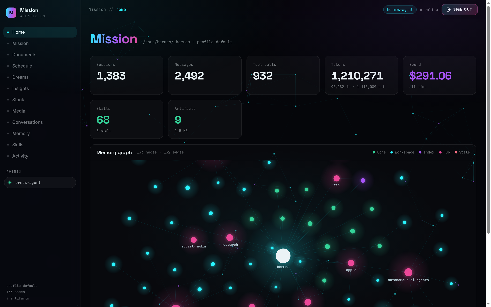

# Mission

A standalone agentic dashboard for [Hermes](https://hermes-agent.nousresearch.com).
Separate project, separate port — it does **not** modify or plug into the Hermes
dashboard. It reads the Hermes home directory read-only and renders it.

Built after the "agentic OS" pattern: one place that shows the agent's memory,
skills, sessions and spend, with the memory graph drawn as a field of glowing
orbs.



## Run

```bash
python3 server.py --port 8081 --host 0.0.0.0
```

Then open http://127.0.0.1:8081

No `pip install`, no `npm install`, no build step — Python 3.9+ standard library
only, and a vanilla HTML/CSS/JS frontend.

Options:

```
--port N            default 8081
--host ADDR         default 127.0.0.1 (use 0.0.0.0 only on a trusted LAN)
--hermes-home PATH  default $HERMES_HOME, else ~/.hermes
--docs-dir PATH     artifact folder, default ~/Documents/hermes
--hermes-bin PATH   hermes CLI used for cron/curator/config reads
--no-delete         serve Documents read-only
```

## Views

| View | Shows |
|---|---|
| **Home** | Stat cards (sessions, messages, tool calls, tokens, spend, skills, artifacts) + the memory graph |
| **Mission** | Kanban tasks, their status, failures and recent worker runs |
| **Documents** | Artifact gallery: filter by type, search, preview, delete |
| **Schedule** | Cron jobs, scheduler heartbeat liveness, recorded executions |
| **Insights** | Curator (skill self-maintenance) status + cost/cache efficiency |
| **Stack** | Model, provider, channels, MCP servers, plugins, profiles, themes |
| **Conversations** | Session list; click one for a read-only transcript |
| **Memory** | Each entry from `memories/*.md` |
| **Skills** | All installed skills, by category, with size and a stale flag |
| **Activity** | Recent sessions with cost, plus a 14-day spend sparkline |

**Conversations is read-only.** It renders transcripts out of `state.db`; it does
not send messages to the agent. Use Telegram, `hermes`, or the Hermes dashboard's
own Chat page for that.

## The memory graph

A force-directed canvas simulation. Every node is Hermes data:

| Colour | Kind | Source |
|---|---|---|
| white | agent | the centre, pinned |
| violet | hub | one per skill category |
| amber | workspace | an installed skill |
| green | core | a memory entry |
| blue | index | a session |
| red | stale | a skill untouched for >14 days |

Controls: **Micro / Mid / Full** thins the node set, **Flow / Pause** freezes the
simulation, **Links / Hide** toggles the edges. Drag to pan, scroll to zoom,
hover an orb for its detail.

## API

| Endpoint | Returns |
|---|---|
| `GET /api/status` | profile, theme, totals, graph stats |
| `GET /api/graph` | nodes + edges + per-kind counts |
| `GET /api/skills` | every skill with category, description, size, staleness |
| `GET /api/memory` | memory entries |
| `GET /api/activity` | recent sessions + 14-day spend buckets |
| `GET /api/mission` | kanban tasks, runs, status counts |
| `GET /api/schedule` | cron listing, heartbeat age, executions |
| `GET /api/stack` | model, provider, channels, MCP, plugins, profiles, themes |
| `GET /api/insights` | curator status + efficiency metrics |
| `GET /api/conversation?id=` | one session's transcript |
| `GET /api/docs` | artifact list + per-type counts |
| `GET /api/docs/raw?path=` | one artifact (CSP-sandboxed) |
| `DELETE /api/docs?path=` | delete one artifact |

## Safety notes

- The Hermes home is opened **read-only**; `state.db` is attached with
  `mode=ro&immutable=1`, so this can never write to or lock the live database.
- `.env`, `auth.json` and `config.yaml` are never served, and the static handler
  refuses any path that escapes `web/`.
- Binds loopback by default. `--host 0.0.0.0` exposes your session titles, cwd
  paths and spend to the network — only do that on a trusted LAN.

## Layout

```
server.py          stdlib HTTP server + Hermes readers
web/index.html     shell
web/style.css      theme
web/app.js         views + the canvas graph
```
